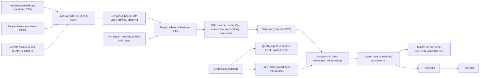

# which-source-wins

Resolves vehicle records from four sources that disagree, picks every field with a written, versioned rule, and shows why each value won.


Full video: https://github.com/ArchiusVuong-sudo/which-source-wins/releases/download/v0.1/demo.mp4

## What it does

- Lands a registration file, dealer listings and module reads as files under SHA-256 keys. When the October registration file arrives with renamed, reordered columns and day-first dates, it is quarantined with a column mapping proposal backed by value checks, and loads only after you approve it.
- Matches records into vehicles in SQL: exact VINs, one-edit VIN repairs when exactly one known VIN is in reach, and attribute blocking for listings with no VIN. It abstains when two vehicles fit, and never links two different valid VINs.
- Shows each vehicle as a golden record: every field has a value, source, tier, as-of date, rule id and version, the values other sources reported, and a reason. Hover a decoded field and the VIN characters its manufacturer pattern reads light up.
- Leaves a field empty when no source has it, and says which sources were checked. Seller words never fill a decoded field; they stay in their own observed trim field.
- Replays a proposed rule change on every vehicle inside a transaction that always rolls back, scores it against the truth labels (correct, wrong, empty), and logs the Accept or Reject with its reason.
- Scores the matcher (pairwise precision, recall, F1), names every false merge and missed match by its planted case, and plans the blocking query on 1,000,000 generated rows with and without its index.

## Architecture



Stack: TypeScript (strict), Hono on Node 22, React with Vite and Tailwind, PGlite 0.5 (Postgres in WASM, on disk under `.data/pg`), the open-source `@cardog/corgi` 2.0.4 decoder with its bundled NHTSA vPIC data, zod and Vitest. No network calls and no keys at runtime.

## How it works

**Sources and landing.** Each file under `data/sources/<source>/<drop-date>.<ext>` is copied to `raw/<source>/<drop-date>/<sha256>.<ext>`. The SHA-256 is unique in `landing_file`, so landing the same bytes again is a no-op.

**Drift guard.** A CSV loads only when its header equals an approved mapping. Otherwise every column is profiled: VIN shape and check-digit pass rate, year range, integer range, vocabularies (makes and aliases, models, colours, province codes) and date order. Day-first is proven only by a first part above 12 in some row. Two date columns are told apart by the rows (a vehicle is registered before its odometer is read). The proposal is saved as mapping v2 only when someone approves it; an ambiguous date order blocks approval.

**Records.** Staging tables feed one `source_record` row per observation. Normalisation is SQL: `vin_norm`, `vin_check_ok` (a plpgsql check digit that a test keeps equal to the TypeScript one), make aliases from a table (`RAM`, `Dodge Ram`, `CHEV`), model keys (`F150` equals `F-150`), and listing titles parsed by longest alias and trim-word match.

**VIN pattern decode.** Every VIN is decoded offline. The decoder still decodes a VIN that fails its check digit, so we check it ourselves and withhold every pattern fact for such a VIN. Trim, series, body, drive, engine, fuel and plant come only from the pattern. A trim or series that lists alternatives (`L/LE/SE/XLE/XSE`) is a shortlist, not a value: the field is null and the reason lists the options. VIN highlights come from each fact's raw pattern (positions 4-8, a pipe, then 10-17).

**Matching.** Exact links on valid VINs. A failing VIN is repaired within one edit (I/O/Q typed for digits, an adjacent swap, one replaced character) only when exactly one known valid VIN is in reach; with two in reach it abstains and names both. A listing with no VIN is blocked on decoded make, model and year, the same seller and a 5,000 km band, and links only when one vehicle fits. Links are pairwise; vehicles are the connected components of the link graph, found with a recursive CTE, and a query counts components holding two valid VINs (0 on every build here).

**Survivorship.** Rules live in `rules/v1.json` and in a `rule_set` table. Winners are one SQL query: `DISTINCT ON (vin, field)` ordered by the rule's source order and then the newest as-of date. Odometer uses the newest reading, and a window function marks any reading below an earlier one, which can never win. Each field comes back as `{value, source, tier, asOf, ruleId, ruleVersion, alsoReported, conflict, reason}`.

**Builds.** Each build writes `full.ndjson` and a `delta.ndjson` against the previous build (added, changed, removed), each with its row count and SHA-256. Build rows are stored as `json`, not `jsonb`, so the stored field order matches the file.

**Rule replay.** A proposal is activated inside a transaction, every golden record is recomputed, the result is diffed per vehicle and scored against the truth, and the transaction rolls back. Accept or Reject needs a reason and goes into the decision log; Accept writes a new build with its delta. On our synthetic set, "VIN pattern, then seller text" for trim moves the score from 15 correct, 0 wrong, 33 empty to 28 correct, 10 wrong, 10 empty: empty beats wrong, so the rule stays.

**Quality.** Pairwise precision, recall and F1 over all loaded records against the truth labels. On our synthetic set after the October drop: 98.5% precision (191 of 194 linked pairs), 95.5% recall (191 of 200 true pairs). The three errors are planted and named: a listing carrying another unit's valid VIN (false merge), fleet twins one edit apart (missed), and a VIN-less listing on a lot with a Classic and a new-generation 1500 (missed).

**Scale check.** A worker thread starts a separate in-memory PGlite, generates 1,000,000 rows and runs `EXPLAIN (ANALYZE, BUFFERS)` on the blocking query before and after a composite index on `(seller, make, model, model_year, km)`. On one run on a laptop: 147 ms without the index, 0.84 ms with it. Your numbers will differ.

**Trade-offs.** PGlite keeps the demo to one `npm start` with real Postgres plans, but it is one connection, so all work goes through one queue. The repair step compares each failing VIN with every known VIN, which is fine at this size; at scale it would block on the VIN prefix first. Abstaining costs recall (the two missed matches) and buys precision.

## Run it

Needs Node 22 (`.nvmrc`) and C build tools for the decoder's native SQLite module (Xcode command line tools on macOS, `build-essential` and Python on Linux).

```bash
npm ci          # install from the lockfile
npm start       # build the server and UI, then serve http://127.0.0.1:4112
npm run reset   # back to the fresh state: October drop quarantined, build #1 only
npm test        # all tests
npm run seed    # rewrite data/ from the seeded script (output is committed)
```

The first start unpacks the decoder's vPIC database (about 80 MB) into `.data/` and writes build #1. Environment variables (see `.env.example`):

| Variable | Default | What it sets |
| --- | --- | --- |
| `PORT` | `4112` | HTTP port |
| `HOST` | `127.0.0.1` | Bind address |
| `DATA_DIR` | `.data` | Postgres data dir, landing folder, builds and decoder data |

There is no live or replay mode: the app has no model calls and needs no login or key.

## Tests

`npm test` runs 56 Vitest tests with no network:

- VIN check digit, normalisation, model year and one-edit repair, and SQL functions that agree with the TypeScript versions on random VINs.
- The decoder: raw pattern to VIN positions, shortlists only for trim and series, facts withheld on a failing check digit.
- The drift guard on both registration drops, day and month order, strict date parsing, blocking on ambiguity.
- Every planted case end to end: the hero truck, the O-for-zero registry VIN, one mistyped character, the VIN-less repost, the abstained Ram and fleet-twin listings, the pasted VIN, the colour conflict, empty fields with reasons, the odometer rollback.
- Builds: delta counts, file hashes, an empty delta when nothing changed, idempotent landing.
- Rule replay isolation (nothing written), reasons required, Accept and Reject paths, and the rule schema.
- The scale check on 30,000 rows (the index is used and returns the same rows).
- One end-to-end test of the main flow over the HTTP API.

## Notes

- All data is synthetic and labelled so in the app: people, lots, serials and readings are made up. VIN prefixes are real manufacturer patterns so the decoder can read them; serials and check digits are invented, and any match to a real vehicle is coincidental. The decoder's vPIC data is the only real reference data.
- Every metric here is measured on our own 48-vehicle synthetic set against its synthetic truth labels. It is not real-world accuracy.
- A production version would land files in object storage and run per-source loaders on a queue, keep staging and golden tables partitioned in a managed Postgres, and block the repair step on the VIN prefix.
- It would also add auth and per-tenant rule sets, review queues for abstained matches, and alerts on drift and on rule-change score drops.
